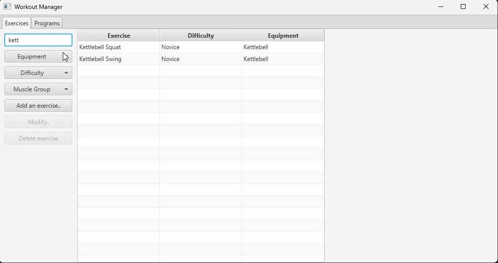
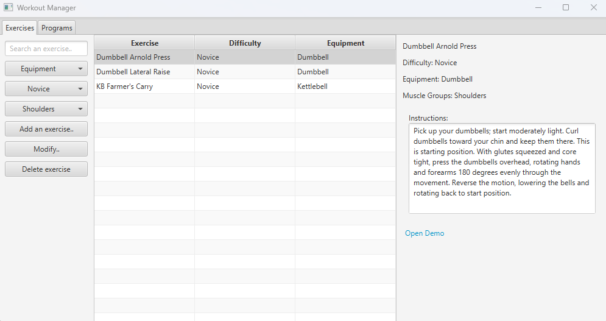
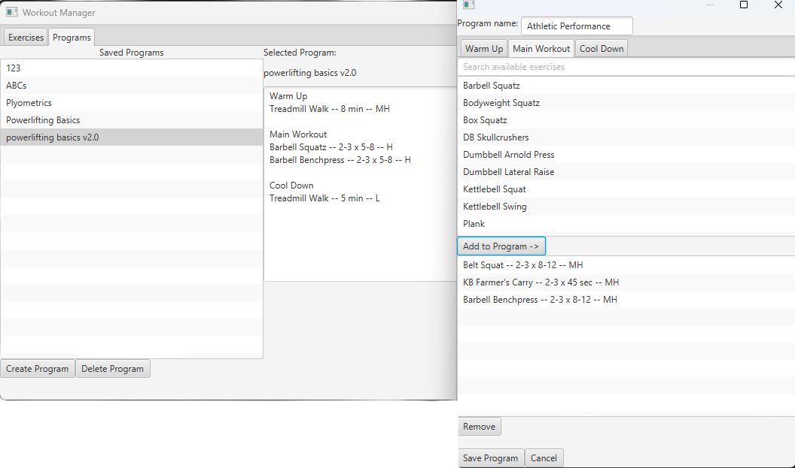

# Workout Manager

## Overview

Workout Manager is a Java desktop application for creating, organizing, and managing
exercise-based workout and mobility programs. 

The application provides a searchable Exercise Library with filtering, full exercise CRUD functionality,
workout program creation, structured workout sections, configurable exercise prescriptions (i.e. sets, reps),
and persistent storage through SQLite and JDBC.

This project began with JSON-based persistence and a simple exercise-only architecture. As the application
grew, the persistence layer was normalized to a SQLite database with repository-based JDBC access, database-generated
IDs, transaction management, foreign-key constraints, and relational mapping between exercises + workout
programs.

Workout Manager was developed as a portfolio project to demonstrate
practical Java development, object-oriented design, GUI programming, relational database design,
JDBC, persistence, validation, controller communication, and application architecture.

## Demo



### Exercise Library



### Program Builder



## Features

### Exercise Library

- Searchable exercise library
- JDBC-backed filtering by:
  - Exercise name
  - Equipment
  - Difficulty
  - Muscle group
- Combined multi-filter support
- Alphabetical search results
- Exercise detail panel
- External exercise demonstration links
- Exercise creation, modification, and deletion
  - Multi-select muscle group assignment
  - Multi-select suitable workout section assignment
  - Input validation
  - URI validation for demo links
- Persistence with SQLite
- Support for exercises without muscle-group associations (i.e. cardio)
- Automatic UI updates through JavaFX observable collections

### Workout Program Builder

- Create complete workout programs
- Organize exercises into
  - Warm up
  - Main workout
  - Cool down
- Section-specific exercise selection
- Exercise prescription support
  - Set/Repetition ranges
  - Duration (value, unit)
  - Intensity
  - Notes
- Input validation

### Program Library

- Persistent saved Workout Programs
- Alphabetical program display
- Detailed workout program display
- Program deletion
- Cascade deletion of dependent workout sections and program exercises
- Persistence through application restarts

## Tech Stack

Java (OpenJDK 27)

JavaFX

FXML

Maven

SQLite

JDBC

Xerial SQLite JDBC Driver

Jackson / JSON -- legacy persistence and migration

Git + GitHub

## Architecture

Workout Manager follows a separation-of-concerns (SoC) approach.
FXML defines the user interface, JavaFX controllers manage user interaction
and UI state, domain classes represent application data, repository classes
handle database operations, and SQLite provides persistent relational storage.

The general application flow is as follows:

```text
JavaFX View
    ↓
Controller
    ↓
MainController coordination
    ↓
Repository
    ↓
JDBC
    ↓
SQLite
```

### Core Domain Model

The primary model relationships are as follows:
```text
WorkoutProgram
    ↓
WorkoutSection
    ↓
ProgramExercise
    ↓
Exercise
```

The `Exercise` class contains structured attributes represented by enums and database relationships,
such as:
- Difficulty
- Equipment
- Muscle groups
- Prescription type
- Movement type
- Suitable workout sections

## Database Design

Workout Manager uses a normalized SQLite database.

Major tables include:
- `Exercise`
- `WorkoutProgram`
- `WorkoutSection`
- `ProgramExercise`
- `Equipment`
- `MuscleGroup`
- `SectionType`
- `ExerciseEquipment`
- `ExerciseMuscleGroup`
- `SuitableSections`

`M:N` relationships are represented using junction tables.

For instance:

```text
Exercise
    ↕
ExerciseMuscleGroup
    ↕
MuscleGroup
```

and:

```text
Exercise
    ↕
SuitableSections
    ↕
SectionType
```

Foreign-key behavior is configured according to ownership.

Deleting a `WorkoutProgram` cascades through its `WorkoutSection` and `ProgramExercise` rows.

Deleting an `Exercise` that is still referenced by a saved workout program is restricted in order
to prevent saved programs from silently losing required data.

SQLite foreign-key enforcement is enabled on each database connection.

## Persistence

### JDBC and SQLite

The application's primary persistence layer uses JDBC with SQLite.

Repository classes are responsible for:
- Creating, loading, updating, and deleting records
- Resolving database relationships
- Retrieving generated IDs
- Filtering data via SQL

Prepared statements are used for parameterized SQL operations.

Database-generated IDs are assigned back to domain objects after successful inserts.

### Transactions

Multistep persistence operations are performed inside explicit transactions.

For example, saving a workout program involves:
```text
INSERT WorkoutProgram
    ↓
INSERT WorkoutSection rows
    ↓
INSERT ProgramExercise rows
    ↓
COMMIT
```

If any operation fails, the entire transaction is rolled back.

Exercise updates follow a similar transactional model. The base Exercise row
is updated, existing junction-table relationships are removed, and the modified
relationships are inserted again within the same transaction.

This prevents partially updated application state.

## Search and Filtering

Exercise filtering is performed through dynamically constructed SQL.

Only active filters contribute conditions to the query.

For instance:

```text
Search text active
Difficulty active
Equipment = All
Muscle group = All
```

may produce conditions equivalent to:

```text
WHERE e.name LIKE ?
AND e.difficulty = ?
ORDER BY e.name
```

SQL conditions and their corresponding parameter values are collected in matching
order and are later bound sequentially to a `PreparedStatement`.

Filters set to `All` are omitted from the query.

`LEFT JOIN` operations are used where relationships are optional so exercises such as
Treadmill Walk can remain in the result set, even when they have no associated muscle-group rows.

## Exercise Creation and Modification

The same Exercise Builder window is reused for both creation and modification.

### Create Mode

The form opens with empty values and produces a new `Exercise`.

### Modify Mode

The existing `Exercise` is passed into the controller and its fields are used
to pre-populate the form.

Rather than mutating the original object before the database persistence succeeds, the form
produces a replacement `Exercise` containing the modified values while retaining the original
database ID.

The application then:

```text
Attempts database UPDATE
    ↓
Commits transaction
    ↓
Replaces original in-memory Exercise
```

If persistence fails, the original in-memory object remains unchanged.

## Controller Communication

Controllers communicate primarily through callbacks rather than directly depending on one another.

Examples include:

- `Exercise`
  - Creation
  - Modification
  - Deletion
- `WorkoutProgram`
  - Creation
  - Deletion
- Exercise search filtering

Java functional interfaces such as `Consumer`, `BiConsumer`, and `Function` are used where appropriate.

This keeps database operations outside the JavaFX form controllers and preserves a clearer separation
between UI behavior and persistence logic.

## Technical Highlights

- JavaFX `TableView` 
  - displays structured data
- JavaFX `TabPane`
  - organizes application material
- Modal secondary-window workflows
- Reusable create/edit Exercise form
- Controller callback architecture
- `ObservableList` application state
- Dynamic SQL query construction
- JDBC prepared statements
- Generated database keys
- Transaction commit and rollback
- SQL foreign-key constraints
- Cascading deletes
- Restricted deletes for referenced records
- Junction table persistence
- Enum-based domain modeling
- URI validation
- Multi-selection controls
- User-facing input validation + error handling
- Java module configuration
- Maven dependency management
- Classpath resource loading

## Notable Challenges

### Migrating from JSON to SQLite

The application originally stored `Exercise` and `WorkoutProgram` data in JSON.

This worked well while persistence was simple and the application mostly loaded and saved
complete collections. However, as the project added more CRUD operations and shared relationships,
the suitability of a relational database became increasingly apparent.

Updating or deleting a single object in a normal JSON array does not behave like a database `UPDATE`
or `DELETE`. In practice, the application would need to read the document, locate the target,
perform the operation (`UPDATE`/`DELETE`), then rewrite the entire file. Even using a stream
would still require re-writing the surrounding document.

These underlying problems with JSON only grew with the introduction of `WorkoutProgram` nested
objects. Modifying an `Exercise` object that is referenced in workouts would require parsing and
re-writing multiple files, going through several nested layers in the latter to prevent stale copies.

The application grew to require more functionality, such as:
- Stable object identity
- `Exercise` updates and deletion by ID
- Shared `Exercise` references inside `WorkoutProgram` objects
- Many-to-many relationships between application entities
- Referential integrity
- Cascading and restricted deletion behavior
- Atomic multistep persistence operations
- Database-backed filtering

Relational database management clearly became the better fit over JSON.

The persistence layer was therefore migrated to SQLite and JDBC. Exercises are now stored
once and referenced throughout with generated database IDs, allowing related records to
point to the same authoritative `Exercise` row rather than storing duplicate serialized copies.

Foreign-key constraints now enforce relationships directly in the database, and transactions
allow multistep operations to either complete successfully or roll back in case of error.

Legacy JSON persistence and migration code remains in the project but is marked as
deprecated. It documents the project's progression and was used to migrate existing
application data into the relational schema.

### Reconstructing Nested Workout Programs

Loading a `WorkoutProgram` requires reconstructing a nested hierarchy:

```text
WorkoutProgram
→ WorkoutSection
→ ProgramExercise
→ Exercise
```

Rather than querying and rebuilding duplicate `Exercise` objects for every `ProgramExercise`,
the application reuses previously-loaded `Exercise` objects through an ID-to-Exercise map.

Furthermore, the actual logic of saving/loading became quite confusing when trying to write the
functions quickly in one big chunk.

After stepping away from the problem and revisiting it with a clearer mind, I decomposed the 
persistence logic for `WorkoutProgram` load/save into smaller methods to follow both 
single-responsibility and separation-of-concerns principles. Each method handles one level 
of the object graph, which makes the code far easier to read, debug, and maintain, as opposed
to one large JDBC function with deeply nested logic.

### Dynamic SQL Filtering

Exercise filtering supports several optional criteria simultaneously.

This was initially quite easy with predicate logic and `FilteredList` objects in JavaFX reading from JSON.

As I moved to SQLite, something more elegant had to be built. Maintaining every possible SQL statement that
could be formed from 4 optional inputs did not seem practical. I started to build around a `switch` statement,
though once this approach became difficult to maintain, I stepped back and reframed the problem. The 
SQL fragments and their corresponding parameter values could be collected separately while 
preserving their order.

The best option seemed to be maintaining two separate lists that mirror indices: one holds the
query fragment, while the other holds the respective parameter to replace `?` inside `PreparedStatement`.

As long as the lists are appended together with their corresponding values, everything seems to work
as expected.

### Nullable JDBC Values

Several `ProgramExercise` fields are optional depending on whether an exercise is repetition-based
or duration-based.

SQLite JDBC nullable integer values are handled using `ResultSet.getInt()` followed immediately by
`ResultSet.wasNull()` being checked inside of a ternary statement.

This wasn't immediately obvious, though it became clearly necessary with some digging.

SQL has its own null semantics, while Java distinguishes between primitives that cannot be null,
and reference types that can. JDBC often requires an explicit conversion step to preserve that 
distinction correctly.

For instance, calling `queryResult.getInt("max_sets")` returns `0` when the SQL value is `null`.
Similarly, `DurationUnit.valueOf(queryResult.getString("duration_unit"))` will produce `NullPointerException`
if the exercise is rep-based and not time-based.

Hence, why extra care was required in loading `ProgramExercise` objects within each `WorkoutSection`.

### Transaction Boundaries

Saving and updating domain objects frequently requires multiple SQL statements.

Transactions are owned by the coordinating layer while repository methods share the same database connection.
This allows all dependent operations to either succeed or roll back together.

`throws SQLException` is included in the repository CRUD function definition without a `catch`. This
allows the Exception to propagate back up to the coordinating layer, where it can be appropriately caught,
and `connection.rollback()` can be called.

Bear in mind that, although it looks awkward, a nested `try` is more or less imperative, particularly
if using the `try-with-resources` statement to open a JDBC connection. When doing so in a single-layer
`try-catch`, the `connection` object is out of scope in the `catch` block, making it impossible to 
initiate a rollback.

Using the nested try allows us to place a `catch` on the inner `try` where all the CRUD operations are called;
exceptions being thrown by database management code will propagate upward to that nested `catch`, allowing
us to properly rollback with `connection` in scope.

### Referential Integrity

Exercises may be referenced by saved workout programs.

Rather than silently removing those references when an Exercise is deleted, the database prevents
deletion while the `Exercise` is still in use by workout program.

This preserves the integrity of saved workout programs, and is checked by SQLite's FK constraint enforcement,
as I had used `ON DELETE NO ACTION` in the case of the `Exercise → ProgramExercise` foreign key layout.

A user-facing `Alert` was also implemented to gracefully handle the error and communicate to the end
user what happened, and why the requested `DELETE` operation was blocked.

### UI State Synchronization

The application maintains both authoritative application collections and UI-specific
displayed collections.

CRUD operations therefore require synchronization between:
- Master `Exercise` collections
- ID lookup maps
- Filtered display results
- Database state

Application testing uncovered several cases where persistence was correct but UI state was stale,
leading to explicit refresh logic following successful create, update, and delete operations.


## Design Decisions

### SQLite as the Final Persistence Layer

JSON was useful during the initial development phase because it allowed the domain model and 
JavaFX workflows to evolve quickly.

SQLite became the better fit once the application required shared identities, many-to-many relationships,
nested workout structures, transactional updates, referential integrity, and more CRUD operability.

### Repository-based persistence

Database logic is kept inside repository classes rather than JavaFX controllers.

This prevents UI controllers from becoming tightly coupled to JDBC implementation details.

### Database IDs as Identity

Database-generated integer IDs are used to identify Exercises and WorkoutPrograms.

Operations such as update and deletion therefore target stable IDs rather than mutable values,
such as names--even if they are upheld with `UNIQUE`.

### Reusing Existing Exercise Objects

`ProgramExercise` objects reference `Exercise` objects that are already loaded into application
memory.

An ID-to-Exercise map allows database relationships to be resolved efficiently without
reconstructing duplicate `Exercise` instances.

### Delete-and-Reinsert Junction Updates

When an `Exercise`'s many-to-many relationships are modified, existing junction-table rows are deleted,
and the current relationships are reinserted.

For the scale of this desktop application, this approach is simpler and cleaner than calculating
individual relationship differences.

### Separate Master and Display Collections

The application distinguishes between the complete in-memory `Exercise` dataset and the current displayed
search results.

This prevents search/filter operations from mutating the application's authoritative collection(s)
(i.e. `allExercises`, `allPrograms`).

## Legacy JSON Persistence

The project originally used Jackson and JSON for persistence.

Legacy JSON methods are retained and marked `@Deprecated` to document the application's progression
and support historical migration logic.

SQLite/JDBC is now the authoritative persistence mechanism used during normal application operation.

## Testing

The application has undergone manual end-to-end testing, covering:

- `Exercise`
  - creation
  - modification
  - deletion
  - search filtering
- Combined search criteria
- UI refresh post-CRUD operations
- Persistence following restart
- `WorkoutProgram`
  - creation
  - deletion
- Nested `ProgramExercise` persistence
- `PrescriptionType`
  - duration-based
  - repetition-based
- Optional `Exercise`/`ProgramExercise` fields
- Cardio exercises without muscle groups
- Foreign-key deletion restrictions
- Cascading deletion
- Alphabetical display ordering

## Future Improvements

Potential future improvements include:

- Automated unit and integration testing
- Application packaging / installer creation
- More advanced workout structures, such as:
  - supersets
  - circuits
  - multi-day programs
- `WorkoutProgram` editing
- Exercise progression/regression relationships
- More advanced program analysis
- Additional filtering/reporting
- Improved database error classification + user-facing error messages

These features are intentionally outside the current project scope.

## Project Status

`Workout Manager` is feature-complete for its current planned scope.

The application now demonstrates:
- Java desktop GUI development
- Object-oriented domain modeling
- JavaFX controller architecture
- Relational database design
- JDBC persistence
- CRUD operations
- SQL filtering
- Transaction management
- Referential integrity
- Data migration
- Application-state synchronization

The project is considered complete in its current form, with
future development reserved for optional enhancements rather than required functionality.